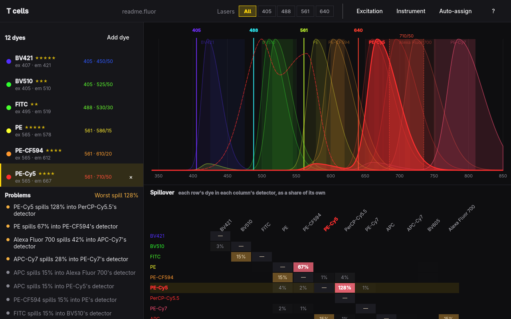

# Fluor

Plan a fluorophore panel against your instrument. Fluor draws each dye's
spectra over your lasers and filters, places every dye on the detector that
sees it best without stepping on the others, and predicts how much of each
dye bleeds into every other dye's detector, so you catch the bad pairs before
you stain anything.



- **Spectra over the instrument.** Emission curves sit over laser lines and
  filter bands. Pick a laser (1–9) and each curve is scaled by how hard that
  laser drives the dye, which is what its detectors actually see.
- **Spillover matrix.** Each row's dye in each column's detector, as a share
  of its own signal. The hot cells are the panel's problems.
- **Problems, in words.** Two dyes on one detector, a dye no laser excites, a
  dye its laser barely reaches, heavy spill (from 25%), lookalike signatures
  that won't unmix, with gentler notes from 10%.
- **Auto-assign.** Places dyes where they're seen best, then trades a little
  signal for a lot less overlap.
- **Your instrument.** Start from a preset (three-, four- and five-laser
  analyzers, a confocal) and retune any laser or filter; dyes follow.
- **Panels are files.** Plain JSON `.fluor` files, saved atomically.

Spectra are modeled from each dye's published peaks and relative brightness,
not measured curves. They tell you which dyes collide and roughly how badly;
confirm a panel with single-stain controls before running it.

## Keys

| Key | Action |
| --- | --- |
| Space | Add a dye (search by name, or type a wavelength) |
| A | Auto-assign every dye to a detector |
| ↑ / ↓ | Select a dye |
| ← / → | Move the dye to the previous or next detector |
| Enter | Choose the dye's detector |
| Delete | Remove the dye |
| 1 – 9 | Show what one laser excites |
| 0 | Show every laser |
| E | Show or hide every excitation curve |
| I | Edit the instrument |
| Ctrl+Z / Ctrl+Shift+Z | Undo / redo |
| Ctrl+N / Ctrl+O | New panel / open a panel |
| Ctrl+S / Ctrl+Shift+S | Save / save as |
| ? | Show every shortcut |
| Q | Quit (asks first when there are unsaved changes) |

## Command line

Every command needs no display, takes `--json`, and exits 0 or 1 with errors
on stderr.

```sh
fluor new panel.fluor --preset vbyr --dye BV421 --dye FITC --dye PE
fluor check panel.fluor          # spillover matrix and problems
fluor assign panel.fluor --all   # place every dye again
fluor dyes 488                   # dyes near a laser line; or by name
fluor presets                    # instruments to start from
fluor help format                # the panel file format
fluor skill install              # teach your coding agent to use Fluor
fluor open panel.fluor           # the planner
```

## Build

Fluor is C++ and Qt Quick, built with qmake6 and make.

```sh
bin/build      # build/fluor
bin/test       # the Qt Test suite, offscreen
bin/install    # makepkg -fsi: installs fluor, its icon and launcher entry
```

It follows the Omarchy theme's accent, Hyprland's window rounding, and the
language picked under Setup > Language, all live.

## License

MIT. The theme and language watching, portal file chooser, and command line
follow Omacut and Hype by David Heinemeier Hansson.
